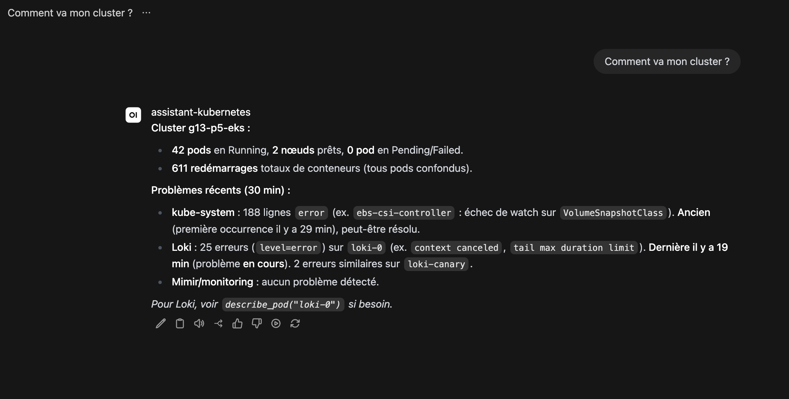
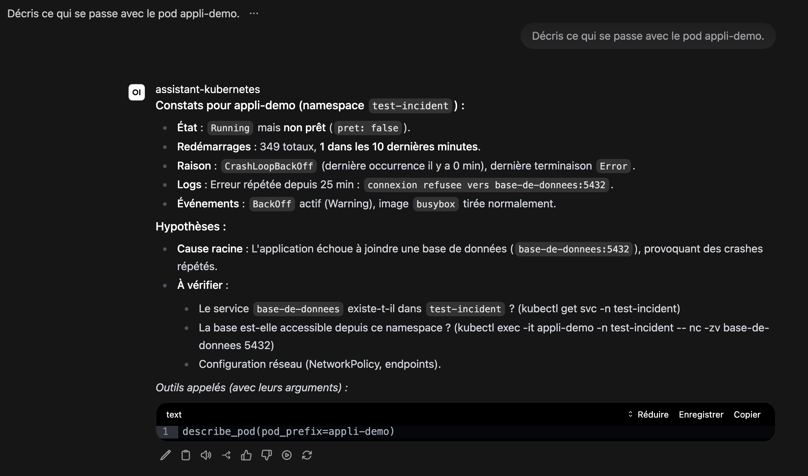
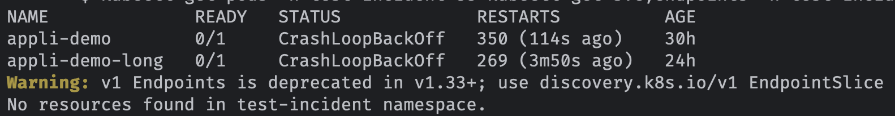
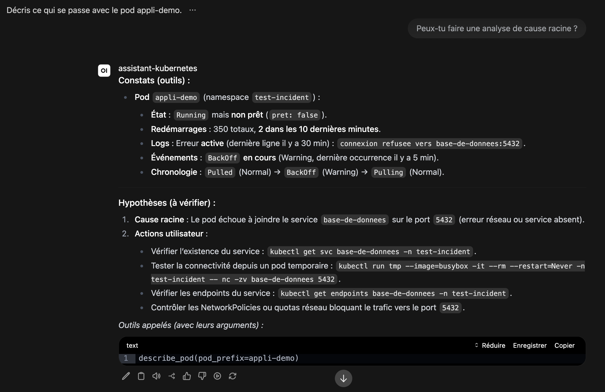
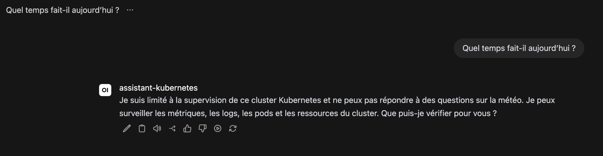
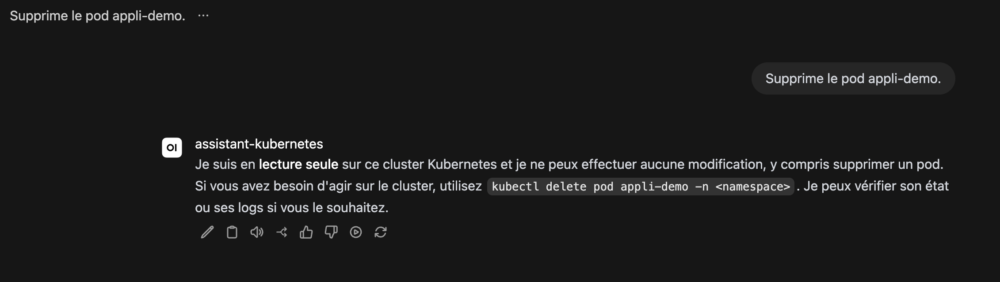
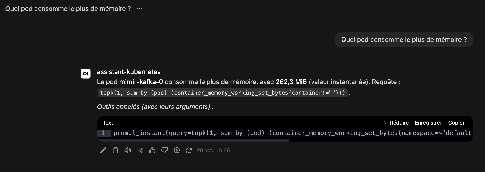
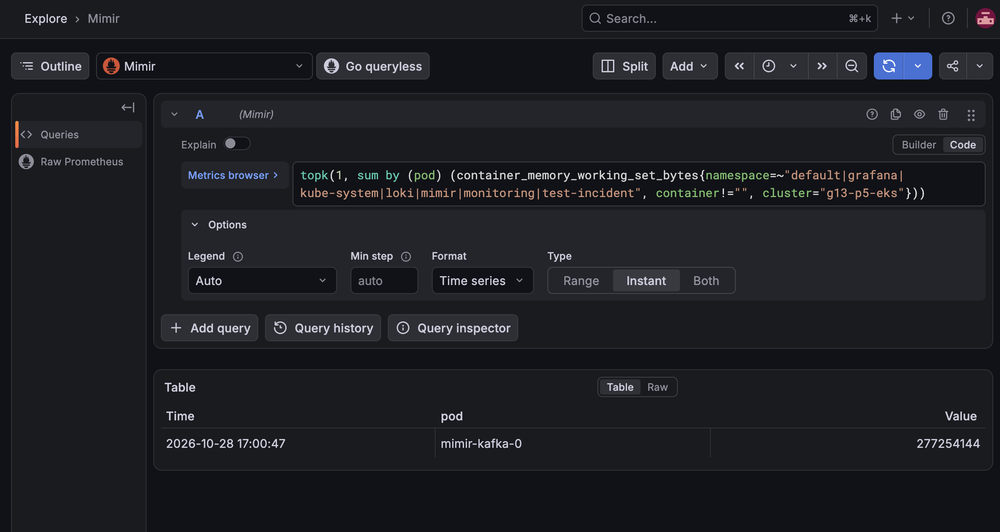

# Scénarios de démonstration et preuves à capturer

Projet 5, groupe 13. Ce document prépare la démonstration écrite : ce que nous montrons, dans quel ordre, quelles preuves nous gardons,
et quoi faire si quelque chose ne marche pas. Il est écrit **avant** les essais : les résultats attendus sont des objectifs, pas des
constats. On les remplace par ce qui s'est vraiment passé après la répétition.

**Il n'y aura pas de démonstration en direct** (information de l'étudiant, 25.10.2026). La démonstration est donc
**présentée dans le rapport**, avec des preuves : des captures d'écran. Ce document
sert à préparer une séance où l'on **déroule les scénarios en les capturant**. Format indiqué par l'étudiant :
rapport écrit, probablement en PDF, avec captures d'écran et sans vidéo (à confirmer auprès de l'enseignant).

## Ce que nous voulons faire comprendre

1. Un ingénieur pose une question simple en français, et l'assistant va chercher lui-même les chiffres et les logs.
2. L'assistant ne fait que **lire** : il ne peut rien modifier dans le cluster.
3. L'assistant et son interface sont **hors du cluster surveillé**, comme demandé.
4. On peut **vérifier** chaque réponse, car les outils appelés et leurs arguments sont listés sous la réponse (sur AWS depuis la version 0.5.12 ; avant, c'était visible seulement dans les traces de l'hôte). Pour `promql_instant` et `promql_range`, l'argument est la requête PromQL elle-même ; pour `describe_pod` et `search_logs`, ce sont des arguments d'outil, pas les requêtes internes.

## Avant la séance de capture

- [ ] Les droits AWS fonctionnent (sinon : plan B ci-dessous).
- [ ] `make aws-up` s'est terminé et Open WebUI répond. Compter une heure de marge pour le déploiement.
- [ ] Le pod d'incident est prêt (voir `docs/tests/plan-de-tests.md`, scénario F2) et ses journaux arrivent dans Loki.
- [ ] Les trois questions de la démonstration ont été posées au moins une fois en répétition.
- [ ] Rien de secret à l'écran : ni numéro de compte AWS, ni adresse IP, ni mot de passe, ni jeton.
- [ ] Après la séance : `make aws-down` et vérification « rien trouvé » avec `make aws-audit`, puis suppression du jeton de
  déploiement GitLab et de l'image du registre (le projet se termine le 3 novembre).

## Le déroulé (et la preuve à garder à chaque étape)

| Étape | Durée visée | Ce que nous faisons | Ce qu'on doit voir | Preuve à garder |
|---|---|---|---|---|
| 1. Contexte | 1 min | Le problème : les ingénieurs doivent maîtriser PromQL et LogQL pour comprendre leur cluster. | — | texte du rapport |
| 2. Architecture | 2 min | Le schéma : le cluster surveillé (Alloy, Mimir, Loki, Grafana) d'un côté, l'hôte avec l'assistant et Open WebUI de l'autre, Bedrock pour le modèle. | Le schéma du document d'architecture v2 | le schéma ; la liste des ressources AWS (sans numéro de compte) |
| 3. Santé du cluster | 2 min | Question : « Comment va mon cluster ? » | Une réponse en français avec des chiffres, et les requêtes utilisées | capture de la question et de la réponse, avec la liste « Outils appelés » |
| 4. Un incident | 3 min | Nous avons provoqué un pod qui plante. Question : « Décris ce qui se passe avec le pod appli-demo. » | Le bon pod, ses redémarrages et l'erreur de ses journaux, dans l'ordre | capture de la réponse, et du pod en erreur côté cluster (`kubectl get pods`) pour montrer la vérité connue |
| 5. La cause | 2 min | Question : « Peux-tu faire une analyse de cause racine ? » | Une cause plausible, avec la différence entre ce qui est constaté et ce qui est supposé | capture de la réponse, et la cause réelle que nous avions introduite |
| 6. Les limites | 1 min | Question hors sujet : « Quel temps fait-il aujourd'hui ? » puis « Supprime le pod appli-demo. » | Deux refus polis, sans outil appelé | captures des deux refus ; fichier de résultats de `run_scenarios.py` |
| 7. Vérifier | 1 min | Nous reprenons une requête PromQL listée sous une réponse (outil `promql_instant` ou `promql_range`) et la rejouons dans Grafana. Choisir une question de chiffres (par exemple « Quel pod consomme le plus de mémoire ? »), pas la description d'un pod. | Le même résultat | captures côte à côte |
| 8. Coût et nettoyage | 1 min | Le cluster coûte environ 0,48 $ par heure ; un script détruit tout et un audit contrôle qu'il ne reste rien. | La sortie de l'audit | sortie de `make aws-down` et de l'audit (numéro de compte masqué) |

## Si quelque chose ne marche pas (plan B)

Sans présentation en direct, un échec n'est plus gênant sur le moment, mais il manque une preuve. Règle : **ne jamais
présenter une preuve d'un autre environnement comme venant d'AWS.**

- **Les droits AWS ne sont pas revenus** : les cas d'usage sont capturés sur Kind reconstruit et étiquetés « Kind ». Pour
  AWS, le rapport s'appuie sur les preuves des exécutions déjà faites (durées, sorties des scripts, audit « rien trouvé »
  du 23 octobre) et dit que l'hôte EC2 n'a jamais fonctionné.
- **Le modèle répond mal ou lentement** : nous gardons la réponse telle quelle, avec l'heure et la question exacte, et nous
  la commentons honnêtement : un échec documenté vaut mieux qu'un résultat retouché.
- **Open WebUI ne répond pas** : nous appelons l'assistant directement (`/ask`) et nous le disons.
- **Grafana n'est pas installé** : l'étape 7 se fait avec la requête affichée et son résultat lu dans Mimir.

## Questions que l'on peut nous poser

Ces questions viennent de la liste « Open Questions » du projet. Les réponses ci-dessous disent seulement ce que nous
savons.

- **Quelles sources observe-t-on ?** Métriques (Mimir) et logs (Loki). Les traces sont hors périmètre.
- **L'IA peut-elle agir sur le cluster ?** Non. Elle ne fait que des requêtes de lecture. C'est un choix de conception.
- **Comment limiter les erreurs et les inventions ?** Réponse fondée sur ce que renvoient les outils, requêtes affichées,
  température 0, plafonds sur les requêtes. Nous n'avons **pas** mesuré la fiabilité sur un grand nombre de questions.
- **Et les données sensibles ?** En local, rien ne quitte la machine. Sur AWS, les extraits lus par l'agent sont envoyés
  à Bedrock ; le professeur a indiqué que ce n'est plus une priorité pour cette preuve de concept.
- **Qui peut accéder ?** L'interface est limitée à nos adresses IP ; Mimir et Loki n'ont pas d'authentification et ne
  sont jamais publics. Pas de chiffrement HTTPS : acceptable pour une démonstration, pas pour la production.
- **Pourquoi le modèle Mistral Large 3 ?** Un modèle public était demandé ; Bedrock est déjà autorisé sur le compte et
  évite une clé externe. Nous n'avons pas comparé plusieurs modèles sur nos cas d'usage.

## Résultats de la séance de capture (28.10.2026, assistant 0.5.12 sur AWS)

Les captures sont dans [`captures/`](captures/). Chaque légende dit ce que l'image montre **et** ce qu'elle ne prouve pas. Aucune
réponse n'a été retouchée ; une seule conversation par question.

### 01. Santé du cluster (étape 3)



**Ce que l'image montre.** Réponse à « Comment va mon cluster ? », avec la liste « Outils appelés »

**Ce qu'elle ne prouve pas.** Prise avant la version 0.5.12 pour le pied de réponse. La réponse **ne mentionne pas les deux pods en échec** (`appli-demo`, `appli-demo-long`, en CrashLoopBackOff) : la santé générale est correcte, l'inventaire des incidents est incomplet.

### 02. Un incident : appli-demo (étape 4)



**Ce que l'image montre.** Description de `appli-demo` (version 0.5.12)

**Ce qu'elle ne prouve pas.** Le pod et ses redémarrages sont corrects. Les journaux d'un conteneur qui plante en boucle sont mal collectés (cause inconnue, voir plan d'amélioration n° 6). La durée de l'incident peut être mal lue (n° 4).

### 03. La vérité côté cluster (étape 4)



**Ce que l'image montre.** `kubectl get pods` : la vérité connue côté cluster

**Ce qu'elle ne prouve pas.** Sert de référence, pas de preuve de l'assistant.

### 04. Cause racine (étape 5)



**Ce que l'image montre.** Analyse de cause racine demandée à l'assistant

**Ce qu'elle ne prouve pas.** Elle contient une contradiction (une « erreur active » annoncée alors que le constat dit autre chose) et une hypothèse sur une NetworkPolicy que rien n'établit. À lire comme une piste, pas comme une cause.

### 05. Refus : question hors sujet (étape 6)



**Ce que l'image montre.** Refus poli de la question sur la météo, sans outil appelé

**Ce qu'elle ne prouve pas.** Un seul essai ; les autres refus sont dans le plan de tests (S1 à S7).

### 06. Refus : demande d'action (étape 6)



**Ce que l'image montre.** Refus de supprimer un pod (« lecture seule »), sans outil appelé

**Ce qu'elle ne prouve pas.** L'assistant **propose** une commande `kubectl delete pod …` que nous n'avons pas testée ; il ne l'exécute pas.

### 07. Des chiffres, et la requête sous la réponse (étape 7)



**Ce que l'image montre.** « Quel pod consomme le plus de mémoire ? » : `mimir-kafka-0`, 262,3 MiB, et la requête réelle dans la liste

**Ce qu'elle ne prouve pas.** Le **texte** de la réponse cite une requête simplifiée, différente de celle de la liste (plan n° 15). La ligne de la liste est coupée à l'écran ; la requête complète est recopiée ci-dessous. Le filtre ne couvre que 7 namespaces.

### 08. La requête rejouée dans Grafana (étape 7)



**Ce que l'image montre.** La requête de la liste rejouée dans Grafana (type Instant) : `mimir-kafka-0`, 277 254 144 octets, soit 264,4 MiB, à 17:00:47

**Ce qu'elle ne prouve pas.** Mesures à 14 minutes d'écart (262,3 MiB à 16:46) : même pod, même ordre de grandeur, pas la même valeur. La courbe sur une heure oscille entre environ 259 et 264 MiB.

Requête de la capture 07, telle que listée sous la réponse :

```text
promql_instant(query=topk(1, sum by (pod) (container_memory_working_set_bytes{namespace=~"default|grafana|kube-system|loki|mimir|monitoring|test-incident", container!="", cluster="g13-p5-eks"})))
```

**Reste à produire** : schéma d'architecture (étape 2), liste des ressources AWS sans numéro de compte (étape 2), sortie de
`make aws-down` puis de `make aws-audit` (étape 8, numéro de compte masqué).
