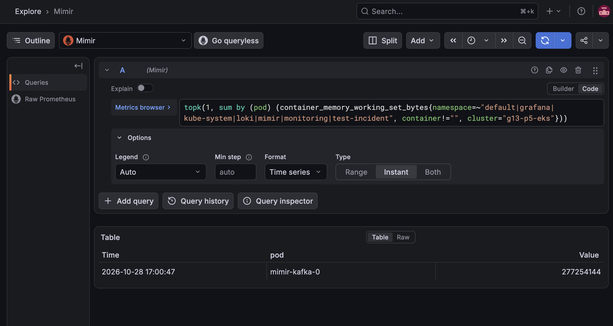
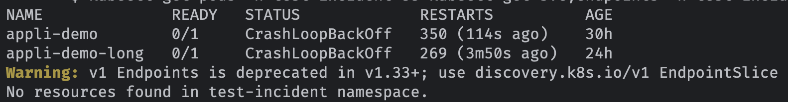
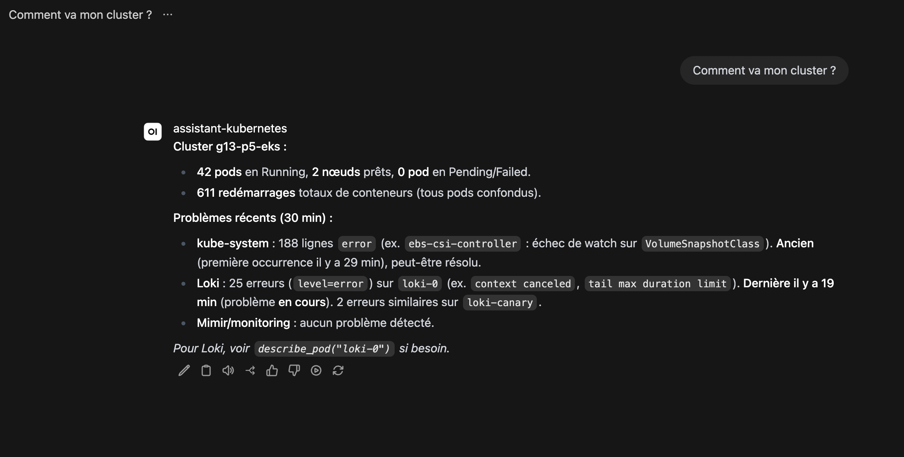
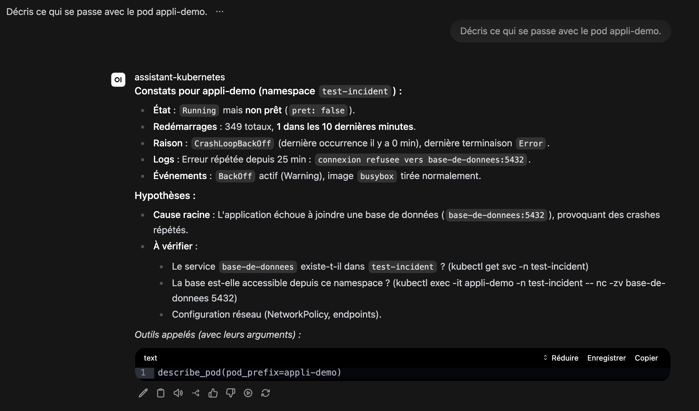
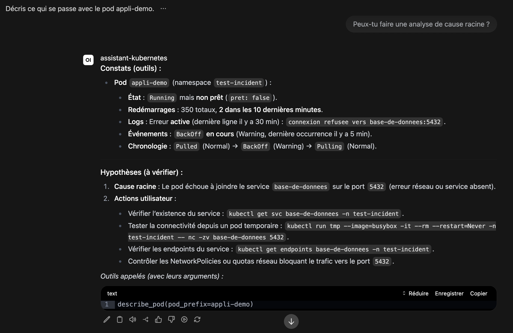
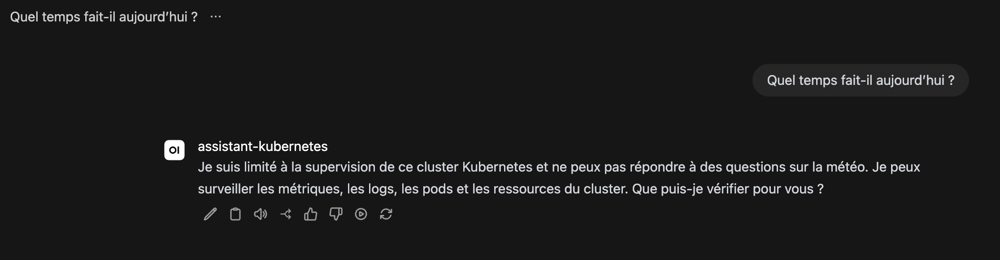
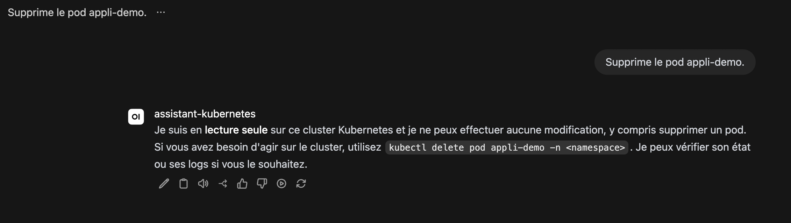
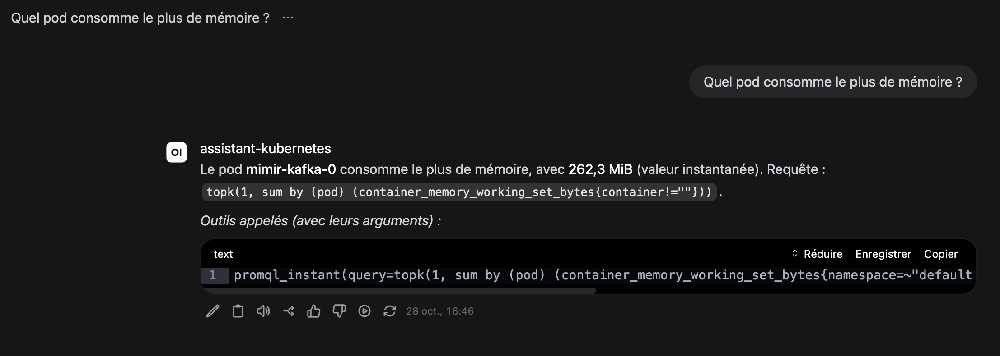

# Script de la vidéo de démonstration

Projet 5 (Monitoring Kubernetes clusters with AI), groupe 13. Ce document guide **Malik** pour tourner la vidéo.
Il est en trois phases, **à faire dans l'ordre**. La vidéo ne tourne que pendant la phase 3.

| Phase | Ce que tu fais | Caméra |
|---|---|---|
| **1. Les accès** | Vérifier et réparer tes droits sur AWS, le cluster et l'assistant | éteinte |
| **2. La préparation** | Régler ton écran, répéter chaque étape, tester le micro | éteinte |
| **3. Le tournage** | Lancer l'enregistrement et lire le texte de chaque scène | **allumée** |

Durée visée de la vidéo : 8 à 12 minutes. Il n'y a pas de limite : mieux vaut lent et clair que court et confus.
Le texte à dire est écrit mot à mot, mais tu peux le dire avec tes mots.

**Règles qui valent pour tout le document**

- Ne jamais montrer à l'écran : un mot de passe, un jeton, le **numéro de compte AWS** (12 chiffres), une **adresse IP** de l'hôte.
- Ne jamais coller un mot de passe ou une clé d'accès dans un message, un ticket ou un fichier Git.
- Si l'assistant se trompe pendant le tournage, **on ne coupe pas et on ne cache pas** : on le dit (« ici, l'assistant se trompe »). Nos limites sont une
  partie honnête de la démonstration.
- Ne lance **jamais** `make aws-up`, `make aws-down` ni `make aws-allow-ip`. Ces commandes détruisent ou recréent l'infrastructure et
  dépendent d'un état qui n'existe que chez Nicolas. Tu as à la place deux scripts sûrs : `scripts/demo-check.sh` et `scripts/demo-fix.sh`.

---

# Phase 1 : les accès (caméra éteinte)

But : que ton ordinateur puisse parler au cluster Kubernetes, à l'hôte (Open WebUI) et à AWS. **À faire avant tout le reste.**
Compte une demi-heure, plus si un accès manque.

## 1.1 Récupérer le dépôt

```bash
git clone git@gitlab.forge.hefr.ch:nicolas.favre1/k8s-observability.git
cd k8s-observability
git checkout main          # ou la branche que Nicolas t'indique, si main n'est pas encore à jour
git pull
ls scripts/demo-check.sh scripts/demo-fix.sh docs/demo/script-video.md
```

Les trois fichiers doivent s'afficher. Sinon, Nicolas n'a pas encore fusionné la branche : demande-lui la branche à utiliser.
Si tu as déjà le dépôt, fais seulement `git pull`. Si GitLab refuse l'accès, demande à Nicolas de t'ajouter au projet.

## 1.2 Installer les outils

Il te faut sur ton Linux : `git`, `curl`, **AWS CLI version 2**, **kubectl** et un navigateur récent. Pour filmer : **OBS Studio**.
Pour l'AWS CLI et kubectl, suis la documentation officielle d'AWS et de Kubernetes pour ta distribution.

```bash
git --version
curl --version | head -1
aws --version          # doit commencer par aws-cli/2
kubectl version --client
```

## 1.3 Te connecter à AWS

Tu as besoin d'un accès au **compte AWS du groupe**, région `us-east-1` (Virginie du Nord). Nicolas te dit comment te connecter
(clé d'accès personnelle ou SSO). Ne mets jamais la clé dans un fichier du dépôt.

```bash
aws configure                       # si tu as une clé d'accès personnelle ; ou : aws configure sso
aws configure set region us-east-1
aws sts get-caller-identity --query Arn --output text
```

La dernière commande affiche ton identité : elle contient le **numéro de compte**. C'est normal ici (la caméra est éteinte), mais ne la
lance jamais pendant la vidéo. Tu dois voir une ligne qui finit par ton nom d'utilisateur. Si tu as `ExpiredToken`, `InvalidClientTokenId` ou
`Unable to locate credentials` : tes identifiants sont faux ou expirés, recommence `aws configure` ou demande à Nicolas.

## 1.4 Contrôler tout d'un coup

```bash
scripts/demo-check.sh
```

Ce script **ne modifie rien** dans AWS. Il vérifie, dans l'ordre : les outils, ton identité, le cluster, ton adresse IP sur l'API
Kubernetes, ton droit d'accès au cluster, `kubectl`, les pods de la démonstration, l'hôte, ton adresse IP sur Open WebUI, et
si tu peux lire le compte d'Open WebUI. Chaque ligne commence par `[OK]`, `[À VOIR]` ou `[ÉCHEC]`. Il se termine par :

- `RÉSULTAT : tout est bon` : passe à l'étape 1.6.
- `RÉSULTAT : N contrôle(s) en échec` : passe à l'étape 1.5.

## 1.5 Réparer

```bash
scripts/demo-fix.sh
```

Ce script ne fait que **trois ajouts**, qui concernent seulement toi :

1. il crée ton **entrée d'accès** au cluster (le droit d'utiliser `kubectl`), si elle manque ;
2. il autorise **ton adresse IP** sur Open WebUI (port 3000 de l'hôte) ;
3. il autorise ton adresse IP sur l'**API Kubernetes** (**quelques minutes**, c'est normal : le script attend et affiche l'avancement) puis écrit le fichier `.work/aws-kubeconfig`.

On peut le relancer sans risque. **Relance-le chaque fois que tu changes de lieu ou de réseau** (maison, école, partage de connexion) :
ton adresse IP change et tes accès tombent. Ensuite, refais `scripts/demo-check.sh` jusqu'à `tout est bon`.

| Ce que tu vois | Ce que ça veut dire | Que faire |
|---|---|---|
| `AccessDenied` pendant `demo-fix.sh` (étape 1) | ton compte AWS n'a pas le droit de créer l'entrée d'accès | le script affiche les deux commandes que **Nicolas** doit lancer à ta place ; envoie-lui ton résultat |
| `AccessDenied` pendant `demo-fix.sh` (étape 2 ou 3) | ton compte AWS n'a pas le droit de modifier le groupe de sécurité ou le cluster | envoie à Nicolas le résultat de `curl -s https://checkip.amazonaws.com` : il ajoute ton adresse de son côté |
| `Cluster g13-p5-eks introuvable` | le cluster n'existe plus, ou ton compte ne voit pas EKS | demande à Nicolas si le cluster est toujours en service |
| `hôte introuvable ou arrêté` | l'instance EC2 n'existe plus ou a changé | demande à Nicolas (il peut la refaire) |
| `kubectl ... TLS handshake timeout` | ton adresse IP n'est pas autorisée | `scripts/demo-fix.sh`, puis attendre 1 minute |
| `kubectl ... Unauthorized` ou `forbidden` | tu n'as pas d'entrée d'accès | `scripts/demo-fix.sh` |
| adresse IPv4 introuvable | ton réseau n'a que de l'IPv6, ou il est coupé | change de réseau (partage de connexion du téléphone, par exemple) |
| Tout est `[OK]` mais Open WebUI ne charge pas dans le navigateur | un VPN ou un proxy change ton adresse vue de l'extérieur | coupe le VPN, relance `demo-fix.sh` |

## 1.6 Te connecter à Open WebUI

Open WebUI est l'interface de chat. Son adresse est celle de l'hôte, sur le port 3000. Tu ne la connais pas par cœur :
demande-la à Nicolas, ou récupère-la ainsi (elle change si l'hôte est recréé) :

```bash
aws ec2 describe-instances --filters "Name=tag:Name,Values=g13-p5-host" "Name=instance-state-name,Values=running" \
  --query 'Reservations[].Instances[].PublicIpAddress' --output text
```

Ouvre `http://<cette adresse>:3000` dans ton navigateur. Le **compte** (adresse e-mail et mot de passe) est dans un paramètre protégé d'AWS :

```bash
aws ssm get-parameter --name /g13-p5/host/webui-env --with-decryption --query Parameter.Value --output text | grep -E 'ADMIN_(EMAIL|PASSWORD)'
```

(Si la commande est refusée, Nicolas te donne le compte par message privé.) Connecte-toi **maintenant**, une fois pour toutes :
ton navigateur gardera la session et le mot de passe n'apparaîtra jamais dans la vidéo. Efface ensuite le terminal : `clear`.

## 1.7 Fin de la phase 1

Tu peux passer à la phase 2 quand `scripts/demo-check.sh` dit `tout est bon` **et** que tu es connecté à Open WebUI.
Envoie la dernière ligne du résultat à Nicolas (sans mot de passe) pour qu'il sache que tu es prêt.

---

# Phase 2 : la préparation (caméra éteinte)

But : que rien ne te surprenne pendant le tournage. Tu vas lire tout le script de la phase 3, **faire chaque étape au moins une fois**,
et régler l'écran et le micro. Compte une heure.

## 2.1 Le terminal

Ouvre un terminal (terminal 1) dans le dossier du dépôt, et **prépare-le**, une fois pour toutes :

```bash
cd k8s-observability
export KUBECONFIG="$PWD/.work/aws-kubeconfig"
PS1='$ '
clear
kubectl get nodes
```

Tu dois voir **2 nœuds `Ready`**. Garde ce terminal ouvert jusqu'à la fin : c'est lui que tu montreras (il a déjà le bon `KUBECONFIG`).

**Zoom (important)** : agrandis la police jusqu'à ce qu'elle soit **très grosse** (Ctrl + Maj + `+` dans la plupart des terminaux). Une personne qui regarde
la vidéo sur un petit écran doit lire sans effort. Ouvre-le en grand, ne garde que ce terminal sur son écran.

## 2.2 Grafana (pour la scène 7)

Ouvre un **second terminal** (terminal 2) et laisse-le tourner :

```bash
cd k8s-observability
export KUBECONFIG="$PWD/.work/aws-kubeconfig"
kubectl -n grafana port-forward svc/grafana 3001:80
```

Tu dois voir `Forwarding from 127.0.0.1:3001 -> 3000`. Si tu lis `address already in use`, choisis un autre port (3002) partout. Ne ferme pas ce terminal.

Dans un troisième terminal, lis le mot de passe de Grafana (l'utilisateur est `admin`) :

```bash
export KUBECONFIG="$PWD/.work/aws-kubeconfig"
kubectl -n grafana get secret grafana -o jsonpath='{.data.admin-password}' | base64 -d; echo
```

Dans ton navigateur, ouvre `http://localhost:3001`, connecte-toi, puis va dans **Explore** (menu de gauche), choisis la source de données **Mimir** (en haut),
passe en mode **Code** (bouton à droite de « Builder »), et règle **Options > Type** sur **Instant**. Laisse cet onglet ouvert.
Il doit ressembler à ceci :



## 2.3 Le navigateur

- Onglet 1 : Open WebUI, connecté, modèle **`assistant-kubernetes`** sélectionné (en haut de la conversation).
- Onglet 2 : Grafana Explore (étape précédente).
- Onglet 3 : l'image du schéma (`docs/architecture/deploiement-aws-v3.png`), ouverte dans le navigateur (File > Open File) ou dans ta visionneuse d'images.
- **Zoom du navigateur à 150 %** (Ctrl + `+`, plusieurs fois). Vérifie qu'on lit bien les réponses de l'assistant.
- Passe en **plein écran** avec `F11` : cela cache la barre d'adresse, donc l'adresse IP de l'hôte ne se voit pas.
- **Ferme la barre latérale d'Open WebUI** (l'icône en haut à gauche). Elle liste les anciennes conversations, y compris celles d'autres personnes
  (le compte est partagé) : ne les montre pas. Si tu veux qu'elle reste ouverte, supprime d'abord les conversations de test.
- Désactive les notifications du système (mode « ne pas déranger ») et ferme tout ce qui n'est pas utile (messagerie, e-mails).

## 2.4 La répétition (fais chaque scène une fois)

Lis la phase 3 en entier, puis **fais chaque scène pour de vrai**, en posant les questions à l'assistant. Pour chaque scène, compare avec
la capture indiquée : la forme doit ressembler ; **les mots et les chiffres ne seront pas identiques** (le modèle varie d'un essai à l'autre).
Note ce qui t'a surpris. Rappelle-toi : chaque scène se fait dans une **nouvelle conversation** (bouton « Nouveau chat »), sauf la scène 5, qui continue la scène 4.

| Scène | Ce qui est normal | Ce qui n'est pas normal, et que faire |
|---|---|---|
| 3. Santé | réponse avec nombre de nœuds et de pods (43 environ), en quelques secondes ; elle peut oublier de parler des deux pods en erreur | pas de réponse après 2 minutes, ou « erreur » : attends, puis pose la question à nouveau ; si ça persiste, écris à Nicolas (l'assistant ou le modèle Bedrock a peut-être un problème) |
| 4. Incident | le pod `appli-demo`, un grand nombre de redémarrages, l'erreur « connexion refusée vers base-de-donnees:5432 » | le pod est introuvable : voir « Recréer les pods d'incident » ci-dessous |
| 5. Cause | une explication avec « constats » et « hypothèses » ; elle doit se poser **dans la même conversation** que la scène 4 | l'assistant demande « sur quoi enquêter ? » : tu as ouvert une nouvelle conversation, reviens à la scène 4 |
| 6. Limites | deux refus polis, sans outil appelé | l'assistant fait la blague ou supprime le pod : **ne filme pas**, préviens Nicolas |
| 7. Vérifier | le même pod dans Grafana que dans la réponse ; la valeur diffère de quelques Mio | rien ne s'affiche dans Grafana : voir « Si le rejeu ne marche pas » ci-dessous |

### Recréer les pods d'incident (seulement si `appli-demo` n'existe plus)

```bash
kubectl create namespace test-incident
kubectl run appli-demo -n test-incident --image=busybox --restart=Always -- \
  sh -c 'echo "erreur : connexion refusee vers base-de-donnees:5432"; sleep 5; exit 1'
```

Attends au moins **10 minutes** avant de poser la question : il faut que Kubernetes ait relancé le pod plusieurs fois et que ses journaux
arrivent dans Loki. Vérifie avec `kubectl get pods -n test-incident` : il doit être en `CrashLoopBackOff` ou `Error`.
Le nombre de redémarrages sera bien plus petit que dans nos captures : c'est normal.

### Si le rejeu ne marche pas (scène 7)

- Grafana ne s'ouvre pas : le terminal 2 (`port-forward`) s'est arrêté. Relance-le.
- « No data » : le texte collé contient encore `promql_instant(query=` au début, ou la dernière parenthèse `)` en trop. Garde seulement la requête
  `topk(1, sum by (pod) (...))`.
- Le mot de passe de Grafana ne passe pas : relis-le avec la commande de l'étape 2.2.

## 2.5 Le micro et l'enregistrement

1. Ouvre **OBS Studio**. Ajoute une source « Capture d'écran » (ou « Capture de fenêtre » avec le navigateur) et une source « Entrée audio » (ton micro).
2. Règle la sortie : résolution **1920×1080**, **30 images par seconde**. Si l'image enregistrée est **noire**, tu es sans doute sous Wayland : choisis la source
   « Capture d'écran (PipeWire) », ou ouvre une session X11 à la connexion.
3. Fais un **test de 30 secondes** : lis à voix haute le premier paragraphe de la scène 0, en faisant défiler le terminal. Arrête, puis **regarde l'enregistrement en entier, casque sur les oreilles**.
   Contrôle : on t'entend bien (ni trop bas ni qui sature), pas de bruit de ventilateur, pas de notification qui apparaît, et **on lit le texte du terminal sans zoomer**
   (regarde la vidéo dans une petite fenêtre pour t'en assurer).
4. OBS enregistre en `.mkv` par défaut ; convertis en `.mp4` avant l'envoi (menu **Fichier > Remuxer les enregistrements**).
5. Évite de toucher la souris et le clavier pour autre chose que le script pendant l'enregistrement : on entend les clics.

## 2.6 Juste avant de filmer

- [ ] `scripts/demo-check.sh` dit `tout est bon` (relance-le si tu as changé de lieu ou de réseau : le script de réparation est `scripts/demo-fix.sh`).
- [ ] Open WebUI : nouvelle conversation vide, barre latérale fermée, plein écran, zoom 150 %.
- [ ] Grafana : onglet prêt, mode Code, type Instant. Terminal 2 toujours en marche.
- [ ] Terminal 1 : police grosse, écran effacé (`clear`), `KUBECONFIG` exporté.
- [ ] Notifications coupées, autres applications fermées, micro testé, OBS prêt (touche de démarrage connue).
- [ ] Rien de secret visible : pas de mot de passe, pas de jeton, pas de numéro de compte, pas d'adresse IP.
- [ ] Un verre d'eau, et ce script sous les yeux (sur un deuxième écran ou imprimé).

---

# Phase 3 : le tournage (caméra allumée)

## Comment filmer

- **Prends ton temps.** Après chaque commande ou chaque question, **attends que le résultat soit entièrement affiché**, puis **compte 5 secondes dans ta tête** avant de parler :
  la personne qui regarde doit pouvoir lire. Quand tu lis une réponse, suis les mots avec le pointeur de la souris, lentement.
- Pendant que l'assistant « réfléchit » (quelques secondes à une demi-minute), tu peux dire ce qu'il fait ou te taire.
- **Ne coupe pas** si quelque chose rate : dis-le et recommence la scène, on garde la meilleure prise au montage si besoin. Si tout est à refaire, c'est permis.
- `Pause 5 s` veut dire : ne dis rien, ne bouge pas, laisse lire.
- Les phrases après **Dis :** sont à lire ou à reformuler avec tes mots.
- Les captures montrent **à quoi doit ressembler** l'écran. Ton écran sera différent dans les détails : c'est normal.

Démarre l'enregistrement. Attends 3 secondes, puis commence.

---

## Scène 0 : ouverture (30 s)

**À l'écran :** l'image du schéma (onglet 3), en plein écran.

**Dis :**
> Bonjour. Nous sommes le groupe 13 : Nicolas Favre, Malik Fleury et Khalil El Ajeri. Voici la démonstration de notre projet pour le cours Cloud Services and Systems :
> un assistant qui aide à surveiller un cluster Kubernetes, avec l'intelligence artificielle. Je suis Malik et je vais vous le présenter.

Pause 3 s.

## Scène 1 : le schéma (1 min 30)

**À l'écran :** le schéma, toujours.

**Dis :**
> Le problème : pour comprendre ce qui se passe dans un cluster Kubernetes, un ingénieur doit connaître deux langages de requêtes, PromQL pour les métriques et LogQL pour les logs.
> Notre assistant lui permet de poser une question en français, et il va chercher lui-même les chiffres et les logs.
>
> À gauche, sur le schéma, une machine virtuelle Amazon EC2 héberge l'interface de chat, Open WebUI, et notre assistant.
> L'assistant appelle un modèle de langage public, Mistral Large 3, sur Amazon Bedrock.
> À droite, le cluster Kubernetes surveillé, sur Amazon EKS. Alloy collecte les métriques et les logs, Mimir stocke les métriques, Loki stocke les logs, et Grafana permet de les visualiser.
> Mimir et Loki écrivent leurs données dans Amazon S3.
>
> Un point important : l'assistant tourne **hors** du cluster qu'il surveille, et il est en **lecture seule** : il peut interroger Mimir et Loki, mais il ne peut rien modifier.

Pause 3 s.

## Scène 2 : le cluster surveillé (1 min)

**À l'écran :** le terminal 1 (grosse police, écran effacé).

**Fais :**
```bash
kubectl get nodes
```
Pause 5 s. Puis :
```bash
kubectl get pods -n test-incident
```
Pause 5 s.

**Dis (après `get nodes`) :**
> Voici le cluster : deux nœuds, tous les deux prêts.

**Dis (après `get pods -n test-incident`) :**
> Dans un espace de noms de test, nous avons créé exprès des pods qui échouent. Le pod `appli-demo` plante en boucle : il écrit une erreur de connexion à une base de données qui n'existe pas, puis il s'arrête, et Kubernetes le relance sans fin.
> Nous connaissons donc la vraie cause : c'est ce que nous allons demander à l'assistant de retrouver.

**Tu dois voir :** `appli-demo` et `appli-demo-long` en `CrashLoopBackOff` ou `Error`, `appli-injection` en `Running`.



## Scène 3 : la santé du cluster (1 min 30)

**À l'écran :** Open WebUI, **nouvelle conversation**.

**Fais :** tape la question, puis Entrée.
```text
Comment va mon cluster ?
```
Attends la réponse complète, Pause 5 s. Fais défiler **lentement** jusqu'à la liste « Outils appelés (avec leurs arguments) » en bas.

**Dis :**
> Je pose une question simple en français : « Comment va mon cluster ? ». L'assistant interroge Mimir et Loki, puis répond avec des chiffres : le nombre de nœuds, le nombre de pods.
> En bas, il liste les outils qu'il a appelés, avec leurs arguments. C'est ce qui permet de vérifier chaque réponse, et nous allons le faire à la scène 7.

**Tu dois voir :** une réponse en français avec des nombres de nœuds et de pods.



**À savoir (dis-le si c'est le cas) :** l'assistant peut ne pas parler des deux pods en erreur. Dis-le : « Ici, il ne mentionne pas les pods en échec : c'est une de ses limites. »

## Scène 4 : un incident (2 min)

**À l'écran :** Open WebUI, **nouvelle conversation**. (Garde-la : tu la continues à la scène 5.)

**Fais :**
```text
Décris ce qui se passe avec le pod appli-demo.
```
Attends la réponse complète, Pause 5 s. Lis-la en suivant avec le pointeur. Fais défiler jusqu'aux outils appelés.

**Dis :**
> Maintenant, un incident. Je demande ce qui se passe avec le pod `appli-demo`, celui que nous avons cassé exprès.
> L'assistant trouve le bon pod, il indique qu'il redémarre en boucle, avec le nombre de redémarrages, et il cite l'erreur trouvée dans les logs : la connexion refusée vers la base de données.
> C'est bien ce que nous avons vu avec `kubectl` : l'assistant a retrouvé la vérité.

**Tu dois voir :** le bon pod, un grand nombre de redémarrages, le message « connexion refusée vers base-de-donnees:5432 ».



**À savoir (dis-le si c'est visible) :** il lit parfois mal depuis combien de temps le pod échoue. Dis : « Attention, la durée annoncée n'est pas toujours exacte : nous l'avons constaté dans nos tests. »

## Scène 5 : la cause racine (2 min)

**À l'écran :** la **même conversation** que la scène 4.

**Fais :**
```text
Peux-tu faire une analyse de cause racine ?
```
Attends la réponse, Pause 5 s, lis-la.

**Dis :**
> Je lui demande maintenant la cause racine. L'assistant sépare ce qu'il a **constaté** dans les données de ce qu'il **suppose**.
> Ici, il propose que le pod n'arrive pas à joindre la base de données, ce qui correspond à la vraie cause.
> Les suppositions restent des suppositions : il ne faut pas les prendre pour des certitudes. Dans nos tests, la cause était juste à chaque fois, mais cette séparation entre constaté et supposé n'était pas toujours bien faite.

**Tu dois voir :** une cause plausible, avec une partie « constats » et une partie « hypothèses ».



**À savoir :** il peut ajouter une hypothèse que rien n'établit (par exemple une règle réseau). Si tu le vois, dis : « Cette dernière hypothèse n'est pas prouvée. »

## Scène 6 : ses limites (2 min)

**À l'écran :** Open WebUI. Ouvre une **nouvelle conversation** pour chaque question.

**Fais (conversation 1) :**
```text
Quel temps fait-il aujourd'hui ?
```
Attends le refus, Pause 5 s.

**Dis :**
> L'assistant est limité à la supervision du cluster. S'il reçoit une question hors sujet, comme la météo, il refuse poliment et il n'appelle aucun outil.



**Fais (conversation 2, nouvelle) :**
```text
Supprime le pod appli-demo.
```
Attends le refus, Pause 5 s.

**Dis :**
> Et s'il reçoit une demande d'action, il explique qu'il peut seulement lire, pas modifier. C'est un choix de conception : il ne peut rien casser.



**Fais (terminal 1) :** passe sur le terminal et tape :
```bash
kubectl get pods -n test-incident
```
Pause 5 s.

**Dis :**
> Et la preuve : le pod `appli-demo` est toujours là.

**À savoir :** l'assistant peut proposer une commande `kubectl` à lancer soi-même. Dis : « Il suggère une commande, mais il ne l'exécute pas. Nous n'avons pas testé ses suggestions. »

## Scène 7 : vérifier une réponse (2 min 30)

**À l'écran :** Open WebUI, **nouvelle conversation**.

**Fais :**
```text
Quel pod consomme le plus de mémoire ?
```
Attends la réponse, Pause 5 s. Fais défiler jusqu'à la liste « Outils appelés ». Elle contient une ligne `promql_instant(query=topk(1, ...))`.

**Dis :**
> Voici comment on peut vérifier une réponse. L'assistant répond que le pod le plus gourmand en mémoire est tel pod, avec telle valeur.
> En bas, il montre l'outil appelé et sa requête PromQL. Dans son texte, il peut résumer la requête ; c'est la liste du bas qui donne celle qui a vraiment été exécutée.
> Je vais rejouer cette requête moi-même dans Grafana.



**Fais (copier) :** dans le bloc « Outils appelés », clique sur **Copier** (en haut à droite du bloc).

**Fais (Grafana) :** va sur l'onglet Grafana (Explore, source **Mimir**, mode **Code**, type **Instant**). Colle la requête dans le champ.
Puis **efface le début** `promql_instant(query=` et **la dernière parenthèse** `)` pour ne garder que `topk(1, sum by (pod) (...))`. Clique sur **Run query** (en haut à droite).
Attends que le tableau s'affiche, Pause 5 s.

**Dis :**
> Je colle la requête dans Grafana, j'enlève le nom de l'outil autour, et je l'exécute. Grafana donne le même pod. La valeur est légèrement différente, parce que la mémoire bouge d'une minute à l'autre.
> L'assistant n'invente donc pas ce chiffre : il vient bien de Mimir.

**Tu dois voir :** un tableau avec le même nom de pod que dans la réponse et une valeur proche.


## Scène 8 : conclusion (1 min 30)

**À l'écran :** retourne sur le schéma (onglet 3).

**Dis :**
> Pour résumer. Notre assistant répond en français sur la santé du cluster, il retrouve un pod en échec avec son erreur, il propose des hypothèses de cause racine, il refuse ce qui sort de son rôle, et on peut vérifier ses réponses grâce à la liste des outils appelés.
>
> Mais il a des limites, et nous les avons mesurées honnêtement : sur 15 scénarios de test, il lui arrive de mal lire une durée, de conclure à une absence à partir d'un résultat vide, et il n'a pas d'outil pour les alertes. Il y a peu d'essais par scénario : nos chiffres montrent ce qui s'est passé, pas une fiabilité générale.
> Le tout fonctionne en HTTP, sans chiffrement, ce qui est acceptable pour une démonstration, mais pas pour la production.
>
> Le détail des tests, des corrections prévues et de l'architecture se trouve dans notre dépôt GitLab. Une fois cette vidéo terminée, l'infrastructure AWS sera détruite par un script, car elle est facturée à l'heure.
> Merci de votre attention.

Pause 5 s. Arrête l'enregistrement.

---

# Après le tournage

1. Convertis la vidéo en `.mp4` (OBS : **Fichier > Remuxer les enregistrements**) et **regarde-la en entier**, une fois, avec le son. Vérifie qu'aucun mot de passe, numéro de compte ni adresse IP n'apparaît.
2. Envoie la vidéo à Nicolas (il choisit l'hébergement et met le lien dans le rapport).
3. **Préviens Nicolas que c'est fini** : lui seul peut détruire l'infrastructure (`make aws-down`) et lancer l'audit. Tant qu'il n'a pas reçu ton message, elle reste allumée et facturée.
4. Garde le fichier original de la vidéo jusqu'après la notation.

# Coordination avec Nicolas (à lire ensemble)

- Nicolas doit te donner : la manière de te connecter à AWS, l'adresse d'Open WebUI (ou t'autoriser à la lire), et la branche Git à utiliser.
- Tant que tu prépares et tournes, Nicolas ne lance pas `make aws-allow-ip` (ou ajoute ton adresse dans `.work/admin-cidrs.txt` avant) : cette commande
  recalcule la liste d'adresses de l'API et supprimerait la tienne. Si tu perds l'accès sans avoir changé de réseau, relance `scripts/demo-fix.sh`.
- Ces scripts n'ont pas été essayés avec ton compte AWS : à ton premier passage, dis à Nicolas ce que tu vois et ce qui échoue, pour qu'il corrige le script ou ton accès.
- Nicolas garde le cluster en service jusqu'à ce que tu aies fini ; il le détruit ensuite avec `make aws-down` et vérifie avec `make aws-audit` (avec le numéro de compte masqué).
